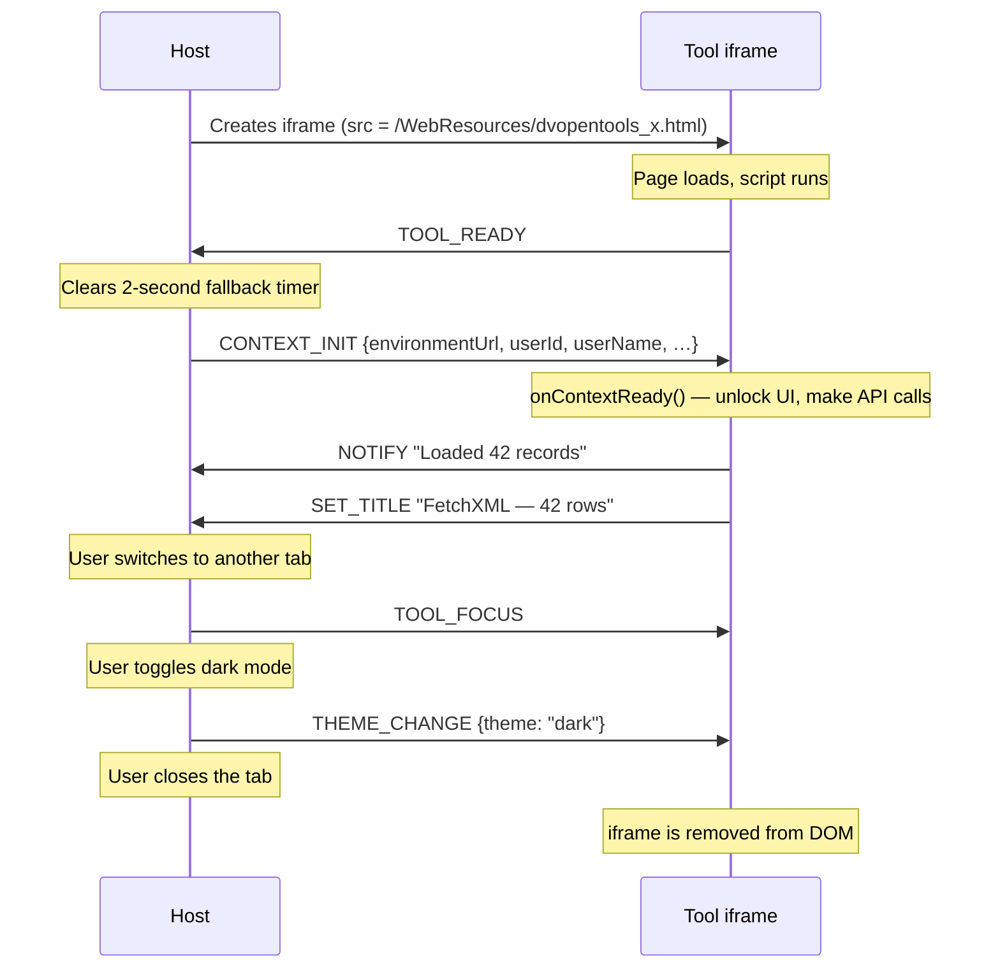

# DV Open Tools — Tool Developer Guide

> **Audience:** Human developers and coding agents building tools for the DV Open Tools host.  
> **Host file:** `dvopentools_host.html` (Power Platform web resource)  
> **Host version:** `2025.11.0`

---

## Table of Contents

1. [What is a Tool?](#1-what-is-a-tool)
2. [Three-Step Quick Start](#2-three-step-quick-start)
3. [File Naming & Upload](#3-file-naming--upload)
4. [Manifest Reference](#4-manifest-reference)
5. [Tool Lifecycle](#5-tool-lifecycle)
6. [postMessage Protocol](#6-postmessage-protocol)
7. [Context Object Reference](#7-context-object-reference)
8. [Calling the Dataverse API](#8-calling-the-dataverse-api)
9. [LocalStorage Contract](#9-localstorage-contract)
10. [Theme Support](#10-theme-support)
11. [Full Annotated Template](#11-full-annotated-template)
12. [Rules — Do and Don't](#12-rules--do-and-dont)
13. [Pre-Upload Checklist](#13-pre-upload-checklist)
14. [Instructions for Coding Agents](#14-instructions-for-coding-agents)

---

## 1. What is a Tool?

A **tool** is a single, self-contained `.html` file that:

- Is uploaded to Power Platform as a **web resource** (HTML type)
- Is automatically discovered and shown in the DV Open Tools sidebar
- Runs inside an **iframe** managed by the host
- Receives environment context (URL, user info, API version) from the host via `postMessage`
- Makes **Dataverse API calls directly** using same-origin `fetch` — no authentication setup required

> [!IMPORTANT]
> A tool **never** hardcodes the environment URL. It always waits for `CONTEXT_INIT` from the host before making any API calls.

---

## 2. Three-Step Quick Start

```
1. Copy tools/dvopentools_template.html
2. Fill in the manifest block (name, id, icon, category)
3. Build your UI + logic using context.environmentUrl for API calls
```

Upload the file as a web resource named `dvopentools_{your-tool-name}.html`.  
The host discovers it automatically on the next sidebar refresh.

---

## 3. File Naming & Upload

### Naming Rule

```
dvopentools_{tool-name}.html
```

| Part | Rule | Example |
|---|---|---|
| Prefix | Must match the host's configured prefix (default: `dvopentools_`) | `dvopentools_` |
| Tool name | Lowercase letters, digits, hyphens. No spaces. | `fetchxml-tester` |
| Extension | Always `.html` | `.html` |

**Valid names:** `dvopentools_fetchxml-tester.html`, `dvopentools_row-counter.html`, `dvopentools_flow-calendar.html`  
**Invalid names:** `dvopentools_FetchXML.html` *(uppercase)*, `dvopentools_host.html` *(reserved)*

### Uploading in Power Platform

1. Open **Power Apps** → **Solutions** → open your solution
2. **New** → **Other** → **Web Resource**
3. Set **Type** to `HTML (htm, html)`
4. **Name:** `dvopentools_{your-tool-name}.html` (no publisher prefix needed here, but add one if your org requires it)
5. Upload the file → **Save** → **Publish**

> [!NOTE]
> The host refreshes its tool list from the Dataverse Web Resource API. After publishing, click the **↻** refresh button in the sidebar or wait for the 5-minute cache to expire.

---

## 4. Manifest Reference

Every tool must embed a JSON manifest block in its `<head>`. The host fetches the tool HTML and reads this block to build the sidebar — before the tool is even rendered.

```html
<script type="application/json" id="dvopentools-manifest">
{
  "id":             "fetchxml-tester",
  "name":           "FetchXML Tester",
  "version":        "1.2.0",
  "description":    "Build and test FetchXML queries with live results and column formatting.",
  "icon":           "🔍",
  "category":       "Query",
  "author":         "Ashish Vishwakarma",
  "minHostVersion": "2025.11.0"
}
</script>
```

### Field Reference

| Field | Type | Required | Rules & Notes |
|---|---|---|---|
| `id` | string | ✅ | Unique across all tools. Use kebab-case. Never change once published — this is how the host tracks open tabs and persisted state. |
| `name` | string | ✅ | Shown in sidebar and tab. Max ~24 chars before truncation. |
| `version` | string | ✅ | Semver: `MAJOR.MINOR.PATCH`. Increment on every change. |
| `description` | string | ✅ | Shown as a tooltip on the sidebar item. 1–2 sentences. |
| `icon` | string | ✅ | A single emoji. Used in sidebar and tab. |
| `category` | string | ✅ | Sidebar grouping. Use an existing category name for consistency (see table below). |
| `author` | string | ⬜ | Your name. |
| `minHostVersion` | string | ⬜ | Minimum host version needed. Host shows a warning badge if it is older. Use `2025.11.0` for current host. |

### Recommended Category Values

| Category | For tools that… |
|---|---|
| `Query` | Execute FetchXML, OData, SQL queries |
| `Data` | Count rows, export, import, bulk operations |
| `Flow` | Inspect or manage Power Automate flows |
| `Metadata` | Explore entities, attributes, relationships |
| `Diagnostics` | View logs, errors, performance data |
| `Utilities` | Miscellaneous helpers |

---

## 5. Tool Lifecycle



> [!NOTE]
> If `TOOL_READY` is never received (e.g. the tool doesn't implement the protocol), the host waits **2 seconds** then sends `CONTEXT_INIT` anyway. Simple tools work fine without the handshake.

---

## 6. postMessage Protocol

All messages use this envelope structure:

```json
{
  "source":  "dvopentools-host",
  "type":    "MESSAGE_TYPE",
  "payload": { }
}
```

**Always verify the sender before processing:**
```javascript
window.addEventListener('message', e => {
  if (e.origin !== window.location.origin) return;      // reject foreign origins
  if (e.data?.source !== 'dvopentools-host') return;    // reject non-host messages
  // safe to process e.data.type and e.data.payload
});
```

---

### 6.1 Messages FROM the Host TO the Tool

#### `CONTEXT_INIT`
Sent once after `TOOL_READY` (or after the 2-second timeout). Contains everything the tool needs.

```json
{
  "source": "dvopentools-host",
  "type": "CONTEXT_INIT",
  "payload": {
    "environmentUrl": "https://orgname.crm.dynamics.com",
    "apiVersion":     "9.2",
    "userId":         "00000000-0000-0000-0000-000000000000",
    "userName":       "Ashish Vishwakarma",
    "userEmail":      "ashish@contoso.com",
    "hostVersion":    "2025.11.0",
    "theme":          "light"
  }
}
```

#### `THEME_CHANGE`
Sent when the user toggles the theme in the host.

```json
{
  "source": "dvopentools-host",
  "type": "THEME_CHANGE",
  "payload": { "theme": "dark" }
}
```
`theme` is `"light"` or `"dark"`.

#### `TOOL_FOCUS`
Sent when the user switches to this tool's tab.  
Use it to re-focus an input, refresh time-sensitive data, resume an animation, etc.  
Payload is empty `{}`.

#### `API_RESPONSE`
Sent back to the tool when a requested `API_REQUEST` has been executed (or rejected) by the host Security Gateway.

```json
{
  "source": "dvopentools-host",
  "type": "API_RESPONSE",
  "payload": {
    "reqId":      "R_x7k92a",
    "ok":         true,
    "status":     200,
    "statusText": "OK",
    "headers":    { "odata-version": "4.0", "preference-applied": "..." },
    "data":       { "value": [...] },
    "error":      null
  }
}
```

---

### 6.2 Messages FROM the Tool TO the Host

Send all messages using:
```javascript
window.parent.postMessage(
  { source: 'dvopentools-tool', type: 'TYPE', payload: { } },
  window.location.origin    // ← always, never '*'
);
```

#### `TOOL_READY`
Signal that the tool has loaded and is ready to receive context.  
**Send this as early as possible** — ideally the first line in your script.

```json
{ "source": "dvopentools-tool", "type": "TOOL_READY", "payload": {} }
```

#### `TOOL_METADATA`
Re-send manifest data to the host. Required for file-loaded tools (the host can't pre-parse their manifest). Optional for WR tools.

```json
{
  "source": "dvopentools-tool",
  "type": "TOOL_METADATA",
  "payload": {
    "id":       "fetchxml-tester",
    "name":     "FetchXML Tester",
    "icon":     "🔍",
    "category": "Query"
  }
}
```

#### `NOTIFY`
Show a toast notification in the host UI.

```json
{
  "source": "dvopentools-tool",
  "type": "NOTIFY",
  "payload": {
    "message":  "Query returned 42 records",
    "level":    "success",
    "duration": 3500
  }
}
```

| Field | Type | Values | Default |
|---|---|---|---|
| `message` | string | Any text | — |
| `level` | string | `"info"` `"success"` `"warning"` `"error"` | `"info"` |
| `duration` | number | Milliseconds | `3500` |

#### `SET_TITLE`
Dynamically update this tool's tab title (e.g. to show a record count or current query name).

```json
{
  "source": "dvopentools-tool",
  "type": "SET_TITLE",
  "payload": { "title": "FetchXML Tester — 42 rows" }
}
```

#### `OPEN_TOOL`
Ask the host to open another tool by its manifest `id`. Useful for cross-tool deep-links.

```json
{
  "source": "dvopentools-tool",
  "type": "OPEN_TOOL",
  "payload": { "toolId": "row-counter" }
}
```

#### `API_REQUEST` (Security Gateway Execution)
Delegate a Dataverse API call to the host. In **Safe Mode** or **Zero Trust**, the host pauses and prompts the user for manual approval with a payload preview before executing the call.

```json
{
  "source": "dvopentools-tool",
  "type": "API_REQUEST",
  "payload": {
    "reqId":   "R_x7k92a",
    "method":  "POST",
    "path":    "/RetrieveTotalRecordCount",
    "headers": { "Prefer": "odata.include-annotations=\"*\"" },
    "body":    { "EntityNames": ["account", "contact"] }
  }
}
```

#### `API_LOG` (Direct Audit Log)
Report an API call to the host Central Network Console and Audit Log. Used when a tool performs fetch directly but wants full audit visibility in the host console.

```json
{
  "source": "dvopentools-tool",
  "type": "API_LOG",
  "payload": {
    "method":     "GET",
    "path":       "/accounts?$top=10",
    "status":     200,
    "statusText": "OK",
    "latency":    45,
    "headers":    { "x-ms-request-id": "..." }
  }
}
```

---

## 7. Context Object Reference

The `context` object (from `CONTEXT_INIT`) contains:

| Property | Type | Example | Notes |
|---|---|---|---|
| `environmentUrl` | string | `"https://orgname.crm.dynamics.com"` | Base URL for all API calls. No trailing slash. |
| `apiVersion` | string | `"9.2"` | Use this in every API URL — don't hardcode a version. |
| `userId` | string (GUID) | `"a1b2c3d4-…"` | Logged-in user's system user ID. |
| `userName` | string | `"Ashish Vishwakarma"` | Display name. May be empty if lookup failed. |
| `userEmail` | string | `"ashish@contoso.com"` | May be empty if lookup failed. |
| `hostVersion` | string | `"2025.11.0"` | Host CalVer. Check against `minHostVersion` if needed. |
| `theme` | string | `"light"` or `"dark"` | Current theme at the time of `CONTEXT_INIT`. Listen for `THEME_CHANGE` for subsequent changes. |

> [!IMPORTANT]
> Store this object immediately in `let context = null` and check it before every API call. Never hardcode `environmentUrl` or `apiVersion`.

---

## 8. Calling the Dataverse API & Security Gateway

### Enterprise Security Gateway & Approval Policies

To protect sensitive environments (Production, UAT, regulated orgs), the host provides an **API Security Gateway** with three configurable policies:

| Policy Mode | Behavior | Recommended Environment |
|---|---|---|
| 🟢 **Audit Only (Permissive)** | All API calls execute immediately. Every call is logged with endpoint, status, latency, and headers in the Central Network Console. | Dev / Sandbox |
| 🟡 **Safe Mode (Prompt on Mutations)** *(Default)* | Read queries (`GET`) execute automatically. Any mutating call (`POST`, `PATCH`, `DELETE`) pauses and prompts the user for manual approval with a payload preview. | UAT / Staging |
| 🔴 **Zero Trust (Strict)** | **Every single API call** (even `GET`) pauses and requires explicit manual approval before execution. | Production |

### Standard Headers

Every Dataverse Web API request needs these headers. The browser auth cookie handles authentication automatically — no token or header required.

```javascript
const REQUIRED_HEADERS = {
  'OData-MaxVersion': '4.0',
  'OData-Version':    '4.0',
  'Accept':           'application/json',
  'Content-Type':     'application/json',
};
```

### Recommended Gateway-Aware `dvFetch` Helper

This helper automatically routes requests through the host's Security Gateway via `postMessage: API_REQUEST`, supporting audit logging and manual approval, with graceful fallback to direct `window.fetch` if running standalone:

```javascript
// Pending gateway requests map
const _pendingApiRequests = new Map();

function uid() {
  return 'R' + Math.random().toString(36).slice(2, 9);
}

// In your message event listener:
window.addEventListener('message', e => {
  if (e.origin !== HOST_ORIGIN) return;
  if (e.data?.source !== 'dvopentools-host') return;

  const { type, payload } = e.data;
  if (type === 'API_RESPONSE' && payload?.reqId) {
    const handler = _pendingApiRequests.get(payload.reqId);
    if (handler) {
      _pendingApiRequests.delete(payload.reqId);
      if (payload.ok) {
        handler.resolve(payload.data);
      } else {
        handler.reject(new Error(payload.error || `HTTP ${payload.status} ${payload.statusText}`));
      }
    }
  }
});

/**
 * Execute Dataverse API call through the Host Security Gateway
 */
async function dvFetch(path, opts = {}) {
  // If running inside host with gateway support
  if (window.parent && window.parent !== window) {
    const reqId = uid();
    return new Promise((resolve, reject) => {
      _pendingApiRequests.set(reqId, { resolve, reject });
      toHost('API_REQUEST', {
        reqId,
        method: opts.method || 'GET',
        path,
        headers: opts.headers || {},
        body: opts.body || null
      });

      // 90s safety timeout to give developer time to review & approve
      setTimeout(() => {
        if (_pendingApiRequests.has(reqId)) {
          _pendingApiRequests.delete(reqId);
          reject(new Error('Dataverse API request timed out waiting for gateway approval'));
        }
      }, 90000);
    });
  }

  // Standalone direct fetch fallback
  const url = `${context.environmentUrl}/api/data/v${context.apiVersion}${path}`;
  const res = await fetch(url, {
    ...opts,
    headers: {
      'OData-MaxVersion': '4.0',
      'OData-Version':    '4.0',
      'Accept':           'application/json',
      'Content-Type':     'application/json',
      ...opts.headers,
    },
  });
  if (!res.ok) {
    const err = await res.json().catch(() => ({}));
    throw new Error(err?.error?.message || `${res.status} ${res.statusText}`);
  }
  return res.json();
}
```

### Common API Patterns

**GET — query records**
```javascript
const data = await dvFetch(
  '/accounts?$select=name,createdon&$filter=statecode eq 0&$top=50&$orderby=createdon desc'
);
// data.value → array of records
```

**GET — single record**
```javascript
const record = await dvFetch(`/accounts(${recordId})?$select=name,revenue`);
```

**GET — with annotations (formatted values, lookup labels)**
```javascript
const data = await dvFetch('/accounts?$select=name,statecode', {
  headers: { 'Prefer': 'odata.include-annotations="*"' }
});
// record['statecode@OData.Community.Display.V1.FormattedValue'] → "Active"
```

**GET — count**
```javascript
const result = await dvFetch('/accounts/$count');
// result → number
```

**POST — create record**
```javascript
const created = await dvFetch('/accounts', {
  method: 'POST',
  body: JSON.stringify({ name: 'Contoso Ltd' }),
});
```

**PATCH — update record**
```javascript
await dvFetch(`/accounts(${recordId})`, {
  method: 'PATCH',
  body: JSON.stringify({ name: 'Updated Name' }),
});
```

**DELETE — delete record**
```javascript
await dvFetch(`/accounts(${recordId})`, { method: 'DELETE' });
```

**POST — FetchXML query**
```javascript
const result = await dvFetch('/accounts/Microsoft.Dynamics.CRM.FetchXMLToQueryExpression', {
  method: 'POST',
  body: JSON.stringify({ FetchXml: '<fetch>…</fetch>' }),
});
```

**GET — WhoAmI**
```javascript
const me = await dvFetch('/WhoAmI');
// me.UserId, me.BusinessUnitId, me.OrganizationId
```

> [!TIP]
> Always `await` inside a `try / catch` and call `notify(err.message, 'error')` in the catch block so the user sees a toast instead of a silent failure.

---

## 9. LocalStorage Contract

> [!IMPORTANT]
> `localStorage` can be **blocked** in secure Power Platform environments, InPrivate/incognito browsing, or under strict enterprise browser policies. **Never call `localStorage` directly.** Always use the tiered `toolStore` / `_store` helper from the template, which falls back automatically.

### Why localStorage can be unavailable

| Scenario | Behaviour |
|---|---|
| InPrivate / Incognito browsing | `localStorage.setItem` throws `SecurityError` |
| Power Platform iframe with strict CSP | `localStorage` access throws or is silently ignored |
| Enterprise browser policy (e.g. `DefaultCookiesSetting`) | `localStorage` and `sessionStorage` both blocked |
| Normal browser session | `localStorage` works as expected |

### Tiered Storage — Use This in Every Tool

Copy this block into your tool. It auto-detects the best available backend.

```javascript
const TOOL_STORE = 'dvopentools::tool::{your-id}::';   // ← set to your manifest id

const _store = (() => {
  function canUse(s) {
    try { const k = '__dvot__'; s.setItem(k,'1'); s.removeItem(k); return true; }
    catch { return false; }
  }
  const _ls  = typeof localStorage  !== 'undefined' && canUse(localStorage)  ? localStorage  : null;
  const _ss  = typeof sessionStorage !== 'undefined' && canUse(sessionStorage) ? sessionStorage : null;
  const _mem = Object.create(null);
  const _b   = _ls || _ss;
  return {
    /** 'localStorage' | 'sessionStorage' | 'memory' */
    type: _ls ? 'localStorage' : _ss ? 'sessionStorage' : 'memory',
    get(k)   { if (_b) try { return JSON.parse(_b.getItem(k)); } catch {} return _mem[k] ?? null; },
    set(k,v) { if (_b) try { _b.setItem(k, JSON.stringify(v)); return; } catch {} _mem[k] = v; },
    del(k)   { if (_b) try { _b.removeItem(k); } catch {} delete _mem[k]; },
  };
})();

function toolStore(key, value) {
  const k = TOOL_STORE + key;
  if (value === undefined) return _store.get(k);
  _store.set(k, value);
}
function toolStoreDel(key) { _store.del(TOOL_STORE + key); }
```

### Fallback behaviour by tier

| Tier | Data survives tab refresh? | Data survives browser close? | Available when? |
|---|---|---|---|
| `localStorage` ✅ preferred | Yes | Yes | Normal sessions |
| `sessionStorage` ⚠️ fallback | Yes | No | InPrivate / some policies |
| `memory` 🔴 last resort | No | No | All other cases |

### Key namespacing rules

Always prefix your keys. Never access host-owned keys.

```
dvopentools::tool::{your-id}::         ← your prefix (OK to read/write)
dvopentools::settings                  ← host-owned (never touch)
dvopentools::tabs                      ← host-owned (never touch)
dvopentools::activeTab                 ← host-owned (never touch)
dvopentools::cache::*                  ← host-owned (never touch)
```

### Usage examples

```javascript
toolStore('lastQuery', '<fetch>…</fetch>');   // write any JSON-serialisable value
const q = toolStore('lastQuery');              // read  (returns null if not found)
toolStoreDel('lastQuery');                     // delete
```

> [!NOTE]
> The host exposes `ls.type` in the status bar (`💾 Persistent`, `💾 Session`, `⚠️ No Storage`). If you see **No Storage**, the tool will work but nothing will be remembered between page loads.

---

## 10. Theme Support

The host broadcasts the current theme on `CONTEXT_INIT` (`context.theme`) and again on `THEME_CHANGE` whenever the user toggles it.

### Minimal theme implementation

```javascript
function applyTheme(theme) {
  document.body.classList.toggle('dark', theme === 'dark');
}

// In CONTEXT_INIT handler:
applyTheme(context.theme);

// In THEME_CHANGE handler:
applyTheme(payload.theme);
```

### CSS approach using a class on `<body>`

```css
body          { background: #fff;     color: #1a1a1a; }
body.dark     { background: #1e1e1e; color: #d4d4d4; }

.card         { background: #f4f4f4; border: 1px solid #ddd; }
body.dark .card { background: #2d2d2d; border-color: #444; }
```

### CSS variables approach (more scalable)

```css
:root {
  --bg:   #ffffff;
  --text: #1a1a1a;
  --card: #f4f4f4;
  --border: #dddddd;
}
.dark {
  --bg:   #1e1e1e;
  --text: #d4d4d4;
  --card: #2d2d2d;
  --border: #444444;
}
body { background: var(--bg); color: var(--text); }
```

Then toggle `.dark` on `<html>` or `<body>`:
```javascript
document.documentElement.classList.toggle('dark', theme === 'dark');
```

> [!NOTE]
> Theme support is **optional** but strongly recommended — the host's dark mode will look inconsistent if the tool iframe stays white.

---

## 11. Full Annotated Template

This is the complete, production-ready starting point. Every section is commented.

```html
<!DOCTYPE html>
<html lang="en">
<head>
  <meta charset="UTF-8">
  <meta name="viewport" content="width=device-width, initial-scale=1.0">
  <title>Tool Name</title>

  <!-- ══ MANIFEST ══════════════════════════════════════════════
       The host reads this before rendering the tool.
       ● id must be unique and stable — never change it after publishing
       ● name appears in the sidebar and tab (keep it short)
       ● icon is a single emoji
       ● category groups tools in the sidebar
  ═══════════════════════════════════════════════════════════ -->
  <script type="application/json" id="dvopentools-manifest">
  {
    "id":             "my-tool",
    "name":           "My Tool",
    "version":        "1.0.0",
    "description":    "What this tool does in one or two sentences.",
    "icon":           "🛠️",
    "category":       "Utilities",
    "author":         "Your Name",
    "minHostVersion": "2025.11.0"
  }
  </script>

  <!-- ══ STYLES ════════════════════════════════════════════════
       Self-contained — no external stylesheets.
       Use CSS variables on :root / .dark for theming.
  ═══════════════════════════════════════════════════════════ -->
  <style>
    :root {
      --bg:      #ffffff;  --text:   #1a1a1a;
      --muted:   #666666;  --card:   #f4f4f4;
      --border:  #dddddd;  --accent: #0078d4;
    }
    .dark {
      --bg:      #1e1e1e;  --text:   #d4d4d4;
      --muted:   #9d9d9d;  --card:   #2d2d2d;
      --border:  #444444;
    }
    *, *::before, *::after { box-sizing: border-box; margin: 0; padding: 0; }
    html, body { height: 100%; }
    body {
      font-family: 'Segoe UI', system-ui, sans-serif;
      font-size: 13px; padding: 16px;
      background: var(--bg); color: var(--text);
      transition: background .2s, color .2s;
    }

    /* ── Your component styles here ── */
    h1    { font-size: 16px; margin-bottom: 14px; }
    label { font-size: 12px; font-weight: 600; display: block; margin-bottom: 4px; color: var(--muted); }
    input, select, textarea {
      width: 100%; padding: 7px 10px; margin-bottom: 10px;
      border: 1px solid var(--border); border-radius: 4px;
      font-size: 13px; font-family: inherit;
      background: var(--card); color: var(--text);
    }
    input:focus, select:focus, textarea:focus { outline: none; border-color: var(--accent); }
    .btn {
      padding: 7px 18px; border: none; border-radius: 4px; cursor: pointer;
      font-size: 13px; font-family: inherit;
      background: var(--accent); color: #fff;
    }
    .btn:hover { opacity: .88; }
    .btn:disabled { opacity: .45; cursor: not-allowed; }
    .output {
      margin-top: 14px; padding: 12px; border-radius: 4px;
      background: var(--card); border: 1px solid var(--border);
      white-space: pre-wrap; overflow-y: auto; max-height: 50vh;
      font-family: 'Cascadia Code', 'Consolas', monospace; font-size: 12px;
    }
  </style>
</head>
<body>

  <!-- ══ HTML ══════════════════════════════════════════════════
       Build your UI here.
       Disable interactive elements until onContextReady() fires.
  ═══════════════════════════════════════════════════════════ -->
  <h1>🛠️ My Tool</h1>

  <label for="query-input">Entity Name</label>
  <input id="query-input" type="text" value="accounts" disabled>

  <button class="btn" id="run-btn" disabled>Connecting…</button>

  <pre class="output" id="output">Results will appear here.</pre>


  <!-- ══ SCRIPT ════════════════════════════════════════════════
       Protocol: TOOL_READY → CONTEXT_INIT → make API calls
  ═══════════════════════════════════════════════════════════ -->
  <script>
    'use strict';

    /* ── 1. Constants ──────────────────────────────────────── */
    const MANIFEST_ID = 'my-tool';          // must match manifest "id"
    const HOST_ORIGIN = window.location.origin;
    const TOOL_STORE  = `dvopentools::tool::${MANIFEST_ID}::`;

    /* ── 2. State ──────────────────────────────────────────── */
    let context = null;   // populated by CONTEXT_INIT

    /* ── 3. Host messaging helpers ─────────────────────────── */
    function toHost(type, payload = {}) {
      window.parent.postMessage(
        { source: 'dvopentools-tool', type, payload },
        HOST_ORIGIN                         // never use '*'
      );
    }

    function notify(message, level = 'info', duration = 3500) {
      toHost('NOTIFY', { message, level, duration });
    }

    function setTitle(title) {
      toHost('SET_TITLE', { title });
    }

    function openTool(toolId) {
      toHost('OPEN_TOOL', { toolId });
    }

    /* ── 4. Send TOOL_READY immediately ────────────────────── */
    //  Do this before any heavy work so the host gets the signal fast.
    toHost('TOOL_READY');

    /* ── 5. Listen for host messages ───────────────────────── */
    window.addEventListener('message', e => {
      if (e.origin !== HOST_ORIGIN)             return; // reject foreign origins
      if (e.data?.source !== 'dvopentools-host') return; // reject non-host messages

      const { type, payload } = e.data;

      if (type === 'CONTEXT_INIT')  { context = payload; onContextReady(); }
      if (type === 'THEME_CHANGE')  { applyTheme(payload.theme); }
      if (type === 'TOOL_FOCUS')    { onFocus(); }
    });

    /* ── 6. Called once context is available ───────────────── */
    function onContextReady() {
      applyTheme(context.theme);

      // Restore persisted state
      const saved = toolStore('lastEntity');
      if (saved) document.getElementById('query-input').value = saved;

      // Unlock UI
      document.getElementById('query-input').disabled = false;
      document.getElementById('run-btn').disabled     = false;
      document.getElementById('run-btn').textContent  = 'Run';
    }

    /* ── 7. Called when user switches to this tab ──────────── */
    function onFocus() {
      // Optional: re-focus primary input
      document.getElementById('query-input')?.focus();
    }

    /* ── 8. Theme ───────────────────────────────────────────── */
    function applyTheme(theme) {
      document.documentElement.classList.toggle('dark', theme === 'dark');
    }

    /* ── 9. Dataverse API helper ────────────────────────────── */
    async function dvFetch(path, options = {}) {
      const url = `${context.environmentUrl}/api/data/v${context.apiVersion}${path}`;
      const res = await fetch(url, {
        ...options,
        headers: {
          'OData-MaxVersion': '4.0',
          'OData-Version':    '4.0',
          'Accept':           'application/json',
          'Content-Type':     'application/json',
          ...options.headers,
        },
      });
      if (!res.ok) {
        const body = await res.json().catch(() => ({}));
        throw new Error(body?.error?.message || `${res.status} ${res.statusText}`);
      }
      return res.json();
    }

    /* ── 10. Tool logic ──────────────────────────────────────── */
    document.getElementById('run-btn').addEventListener('click', async () => {
      if (!context) return;

      const entity = document.getElementById('query-input').value.trim();
      if (!entity) { notify('Please enter an entity name.', 'warning'); return; }

      const btn = document.getElementById('run-btn');
      const out = document.getElementById('output');
      btn.disabled = true;
      btn.textContent = 'Loading…';
      out.textContent = '';

      try {
        // ── Replace with your actual query ────────────────────
        const data = await dvFetch(`/${entity}?$top=10`);
        // ─────────────────────────────────────────────────────

        out.textContent = JSON.stringify(data.value, null, 2);
        const count = data.value?.length ?? 0;

        notify(`Loaded ${count} records from ${entity}`, 'success');
        setTitle(`My Tool — ${entity} (${count})`);

        // Persist last-used entity
        toolStore('lastEntity', entity);
      } catch (err) {
        out.textContent = `Error: ${err.message}`;
        notify(err.message, 'error');
      } finally {
        btn.disabled = false;
        btn.textContent = 'Run';
      }
    });

    /* ── 11. Per-tool localStorage helpers ───────────────────── */
    function toolStore(key, value) {
      const fullKey = TOOL_STORE + key;
      if (value === undefined) {
        try { return JSON.parse(localStorage.getItem(fullKey)); }
        catch { return null; }
      }
      try { localStorage.setItem(fullKey, JSON.stringify(value)); }
      catch {}
    }
  </script>
</body>
</html>
```

---

## 12. Rules — Do and Don't

### ✅ Always Do

| Rule | Why |
|---|---|
| Send `TOOL_READY` as the **first line** of your script | Keeps startup fast; minimises the chance the host timeout fires first |
| Check `if (!context) return` before any API call | Context may not have arrived yet if the tool button is clicked immediately |
| Use `context.environmentUrl` and `context.apiVersion` in every URL | Same file works in dev, UAT, and prod without editing |
| Prefix all `localStorage` keys with `dvopentools::tool::{id}::` | Prevents collisions with host and other tools |
| Catch all `dvFetch` errors and call `notify(err.message, 'error')` | Silent failures are confusing for users |
| Call `setTitle(...)` after a significant data load | Gives the tab a meaningful label |
| Self-contain everything (inline all CSS and JS) | No external CDN dependency; works fully offline in the Power Platform iframe sandbox |

### ⛔ Never Do

| Rule | Why |
|---|---|
| Hardcode `https://orgname.crm.dynamics.com` | The file must be environment-agnostic |
| Use `*` as the `postMessage` target origin | Security — always use `window.location.origin` |
| Read or write `dvopentools::settings`, `dvopentools::tabs`, or other host keys | Those are host-owned; writing to them breaks the host |
| Load external scripts or stylesheets (CDN, `unpkg`, etc.) | Power Platform CSP may block external origins; keep tools self-contained |
| Use `alert()`, `confirm()`, or `prompt()` | They block the host iframe; use inline UI or `notify()` instead |
| Use `window.top` or `window.location` for navigation | Breaks the iframe model and may throw security errors |
| Use `eval()` or `innerHTML` with unsanitized user data | XSS risk; use `textContent` or `innerText` for user-supplied strings |
| Make bulk write/delete operations without explicit user confirmation | Could cause irreversible data loss |

---

## 13. Pre-Upload Checklist

Run through this before publishing your tool as a web resource.

```
MANIFEST
  [ ] id is unique, kebab-case, and matches MANIFEST_ID in the script
  [ ] name is short and clear (fits in a ~180px tab)
  [ ] icon is a single emoji
  [ ] category matches one of the recommended values
  [ ] minHostVersion is set to 2025.11.0 or later

PROTOCOL
  [ ] toHost('TOOL_READY') is called at the top of the script
  [ ] message listener checks event.origin === window.location.origin
  [ ] message listener checks event.data?.source === 'dvopentools-host'
  [ ] onContextReady() unlocks the UI (buttons, inputs re-enabled)
  [ ] THEME_CHANGE is handled

API CALLS
  [ ] All API calls happen AFTER context is set
  [ ] environmentUrl and apiVersion come from context, not hardcoded
  [ ] All fetch calls are inside try/catch
  [ ] Errors are shown to user via notify()

STORAGE
  [ ] All localStorage keys start with dvopentools::tool::{id}::
  [ ] No keys starting with dvopentools::settings or dvopentools::tabs

GENERAL
  [ ] No external stylesheets or scripts
  [ ] No alert() / confirm() / prompt()
  [ ] No innerHTML with unsanitized user input
  [ ] File named dvopentools_{name}.html
  [ ] Uploaded as HTML web resource type
  [ ] Published in Power Platform
```

---

## 14. Instructions for Coding Agents

> This section is specifically for AI coding assistants generating tool files. Follow these rules precisely.

### Input you will receive

The user will describe a tool they want. Extract:
- **What it does** → manifest `description`
- **Which entities/APIs it touches** → determines the query pattern
- **What UI they want** → form fields, results table, etc.
- **What to call it** → manifest `name`, `id` (kebab-case), and filename

### Output you must produce

A **single self-contained `.html` file** named `dvopentools_{id}.html`.

### Non-negotiable structural rules

1. `<script type="application/json" id="dvopentools-manifest">` block must be the **first child of `<head>`**.
2. `toHost('TOOL_READY')` must be **the first statement** inside the `<script>` block at the bottom.
3. The `message` event listener must check **both** `e.origin` and `e.data?.source` before processing.
4. All interactive elements (`<button>`, `<input>`, `<select>`) must start **`disabled`** and be enabled inside `onContextReady()`.
5. Every `dvFetch` call must be wrapped in `try/catch`. The catch block must call `notify(err.message, 'error')`.
6. The `dvFetch` helper must construct URLs as `${context.environmentUrl}/api/data/v${context.apiVersion}${path}`.
7. **Never call `localStorage` directly.** Use the tiered `_store` / `toolStore` helper from the template. It falls back through `sessionStorage` → in-memory so the tool works even when `localStorage` is blocked by browser security policy.
8. No external `<script src>` or `<link rel="stylesheet">` tags.
9. No `alert()`, `confirm()`, `prompt()`.
10. No hardcoded environment URLs or API versions.

### Variable naming conventions

| Variable | Required name |
|---|---|
| Manifest id constant | `MANIFEST_ID` |
| Host origin constant | `HOST_ORIGIN` |
| localStorage prefix constant | `TOOL_STORE` |
| Context object | `context` |
| postMessage helper | `toHost(type, payload)` |
| Dataverse fetch helper | `dvFetch(path, options)` |
| localStorage helper | `toolStore(key, value?)` |
| Context ready callback | `onContextReady()` |
| Theme apply function | `applyTheme(theme)` |
| Tab focus callback | `onFocus()` |

### Code generation checklist (run before emitting)

```
[ ] Manifest id matches MANIFEST_ID string
[ ] toHost('TOOL_READY') is first line of script
[ ] Message listener has origin check AND source check
[ ] All inputs disabled at render time
[ ] onContextReady() enables all inputs
[ ] Every dvFetch is in try/catch with notify on error
[ ] applyTheme called in CONTEXT_INIT and THEME_CHANGE handlers
[ ] localStorage uses TOOL_STORE prefix
[ ] No external dependencies
[ ] File name matches manifest id: dvopentools_{id}.html
```

### Minimal valid skeleton (reference)

```html
<!DOCTYPE html>
<html lang="en">
<head>
  <meta charset="UTF-8">
  <title>{name}</title>
  <script type="application/json" id="dvopentools-manifest">
  { "id":"{id}","name":"{name}","version":"1.0.0","description":"{desc}","icon":"{icon}","category":"{cat}","minHostVersion":"2025.11.0" }
  </script>
  <style>/* styles */</style>
</head>
<body>
  <!-- UI with all inputs disabled -->
  <script>
    'use strict';
    const MANIFEST_ID = '{id}';
    const HOST_ORIGIN = window.location.origin;
    const TOOL_STORE  = `dvopentools::tool::${MANIFEST_ID}::`;
    let context = null;

    function toHost(type, payload = {}) {
      window.parent.postMessage({ source: 'dvopentools-tool', type, payload }, HOST_ORIGIN);
    }
    function notify(msg, lvl = 'info', ms = 3500) { toHost('NOTIFY', { message: msg, level: lvl, duration: ms }); }
    function setTitle(t)   { toHost('SET_TITLE', { title: t }); }
    function openTool(id)  { toHost('OPEN_TOOL', { toolId: id }); }
    function toolStore(k, v) {
      if (v === undefined) { try { return JSON.parse(localStorage.getItem(TOOL_STORE + k)); } catch { return null; } }
      try { localStorage.setItem(TOOL_STORE + k, JSON.stringify(v)); } catch {}
    }
    async function dvFetch(path, opts = {}) {
      const res = await fetch(`${context.environmentUrl}/api/data/v${context.apiVersion}${path}`, {
        ...opts, headers: { 'OData-MaxVersion':'4.0','OData-Version':'4.0','Accept':'application/json','Content-Type':'application/json', ...opts.headers }
      });
      if (!res.ok) { const b = await res.json().catch(()=>({})); throw new Error(b?.error?.message || `${res.status}`); }
      return res.json();
    }

    toHost('TOOL_READY');  // ← must be first

    window.addEventListener('message', e => {
      if (e.origin !== HOST_ORIGIN)              return;
      if (e.data?.source !== 'dvopentools-host') return;
      const { type, payload } = e.data;
      if (type === 'CONTEXT_INIT') { context = payload; onContextReady(); }
      if (type === 'THEME_CHANGE') { applyTheme(payload.theme); }
      if (type === 'TOOL_FOCUS')   { onFocus(); }
    });

    function applyTheme(theme) { document.documentElement.classList.toggle('dark', theme === 'dark'); }
    function onFocus() { /* optional */ }
    function onContextReady() {
      applyTheme(context.theme);
      // enable UI elements here
    }

    // tool logic here
  </script>
</body>
</html>
```

---

## 15. Host Shared UI/UX Kit & `window.DV` SDK (`v2025.11.1+`)

To keep tools ultra-lightweight without duplicating CSS resets, dark-mode tokens, table/card styling, or Dataverse fetch/CSV boilerplate, `dvopentools_host.html` automatically injects:

1. **`#dvopentools-shared-css`** into `<head>` (prepended so tool-specific CSS overrides cleanly).
2. **`window.DV`** into the iframe before `CONTEXT_INIT`.

### Opting In (`<body class="dv-app">`)

Add `class="dv-app"` on `<body>` to activate the host's full design system:

- **Layout:** `.dv-toolbar`, `.dv-strip`, `.dv-split` (`.dv-pane-left`, `.dv-pane-right`), `.dv-scroll`, `.dv-pad`, `.dv-spacer`, `.dv-footer`
- **Controls:** `.dv-btn`, `.dv-btn-primary`, `.dv-btn-sm`, `.dv-seg-group` / `.dv-seg-btn.active`, `.dv-tabs` / `.dv-tab-btn.active`, `.dv-field`
- **Data Display:** `.dv-card` (`.dv-card-hdr`, `.dv-card-body`), `.dv-table`, `.dv-badge` (`.dv-b-ok`, `.dv-b-warn`, `.dv-b-err`, `.dv-b-info`, `.dv-b-muted`), `.dv-kv-grid` / `.dv-kv-card`, `.dv-code`, `.dv-empty`, `.dv-err-banner`, `.dv-pill`
- **Modals:** `.dv-overlay` / `.dv-modal`

### `window.DV` Runtime API

| Method / Property | Purpose |
|---|---|
| `DV.fetch(path, opts)` | Same-origin Web API v9.2 call (transparently enforced by Host Security Gateway Safe Mode / Zero Trust), updates `#tel-pill` / `#tel-msg`, and binds `#tel-pill` click to `DV.showHeaders()`. |
| `DV.showHeaders()` | Opens the host's built-in HTTP Response Headers inspector modal for the current tab's last request. |
| `DV.store(toolId)` | Tiered storage (`localStorage` → `sessionStorage` → memory) with `.get(k, d)`, `.set(k, v)`, `.del(k)`. |
| `DV.openTool(toolId, data)` | Opens/focuses another tool and delivers `data` via `CONTEXT_INIT.launchData` and `TOOL_LAUNCH`. |
| `DV.exportCsv(file, cols, rows)` | Exports UTF-8 BOM CSV with formula-injection protection. |
| `DV.exportJson(file, data)` | Downloads formatted JSON. |
| `DV.copyText(text, msg)` | Copies to clipboard and displays a host toast. |
| `DV.notify(msg, level, ms)` | Shows a host toast notification. |
| `DV.setTitle(title)` | Updates the active tab title. |
| `DV.esc(str)` | HTML-escapes strings safely. |
| `DV.ui.empty / error / badge` | Ready-to-render HTML fragments for empty states, error banners, and badges. |

*(See `tools/dvopentools_template.html` for the minimal `<body class="dv-app">` starter.)*

---

## 16. Local Development Servers (`dev-server/`)

To develop and test tools locally (or run `dvopentools_host.html` directly from `file://` or an external domain) against a live Dataverse environment **without** putting Environment URLs or Bearer tokens into the browser, run any of the three equivalent local proxies in [`dev-server/`](dev-server/README.md):

```powershell
# PowerShell (Windows zero-install)
.\dev-server\dev-server.ps1 -Env https://yourorg.crm.dynamics.com

# C# / .NET 8+
dotnet run --project dev-server -- --env https://yourorg.crm.dynamics.com

# Node.js
node dev-server/dev-server.js --env https://yourorg.crm.dynamics.com
```

Then either:
- **Recommended:** Open **http://127.0.0.1:8787/dvopentools_host.html** directly (same-origin, zero CORS, zero Mixed Content — Proxy URL auto-defaults to `http://127.0.0.1:8787`), **OR**
- **External / `file://` Host Mode:** Open `dvopentools_host.html` directly from disk (`file:///.../dvopentools_host.html`) or an external static domain. The host automatically detects that it is running outside Power Platform (`*.dynamics.com`) and asks **only for your local Proxy URL** (e.g. `http://127.0.0.1:8787`).

How it works:
- Serves `index.html` at `/` (and `dvopentools_host.html` at `/dvopentools_host.html`) plus all `tools/dvopentools_*.html` files straight from disk (`/WebResources/*`) with no upload step and no browser caching.
- Static hosts like GitHub Pages use `tools/manifest.json` so `dvopentools_host.html` discovers tools inside `./tools/` even before connecting a local proxy (regenerate after adding a new tool with `node dev-server/dev-server.js --build-manifest`, `dotnet run --project dev-server -- --build-manifest`, or `.\dev-server\dev-server.ps1 -BuildManifest`).
- **Multi-tool Web Resource Bundles**: Keeps `dvopentools_host.html` independent while packing any subset or all tools into a single `dvopentools_bundle_*.html` file via the Bundle Builder on `index.html` or `--build-bundle` (`node dev-server/dev-server.js --build-bundle`). `dvopentools_host.html` unpacks `#dvopentools-bundle` automatically from both Dataverse Web Resources and local file import (`Load Tool from File`).
- Merges un-uploaded local tools into `/api/data/*/webresourceset` discovery automatically.
- Acquires and caches OAuth Bearer tokens **strictly server-side** via `pac auth token` or `az account get-access-token` (`DV_TOKEN` env var optional) — Environment URL and Bearer tokens never touch browser JS or storage.
- Enables CORS + Chrome Private Network Access headers (`Access-Control-Allow-Origin: *`, `Access-Control-Allow-Private-Network: true`) and exposes `GET /_proxy/status` (metadata only) so external/local-file hosts connect cleanly.
